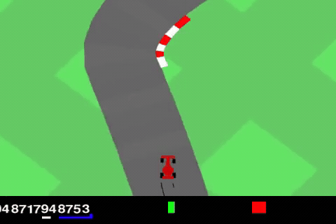

# CarRacing PPO

Continuous-control agents for Gymnasium **CarRacing-v3**, with basic and IMPALA-style residual CNN encoders, reproducible checkpoint selection, and image-only inference.

The environment supplies a `96 × 96 × 3` RGB image. The agent returns three continuous controls: steering `[-1, 1]`, gas `[0, 1]`, and brake `[0, 1]`. Evaluation allows 3,000 simulator steps, or 60 simulator seconds. An unfinished race receives a 70-second DNF score. Lower mean penalized race time is better.

## Race preview



A short straight-line highlight from the trained driver's run, with the car staying on the road. Shown at the original playback speed. [Watch or download the MP4](docs/assets/carracing-highlight.mp4).

## Architectures

Both configurations use **PPO with generalized state-dependent exploration (gSDE)**. Observations are converted to grayscale, resized to `84 × 84`, and stacked over four decision times. The shared encoder produces 256 features. Separate 64-unit Tanh heads predict three action-distribution means and one value estimate. Training samples controls; evaluation uses bounded deterministic mean controls.

**Basic CNN — current submission candidate**

Three convolution/ReLU pairs use 32 filters with kernel 8/stride 4, 64 filters with kernel 4/stride 2, and 64 filters with kernel 3/stride 1. The resulting `64 × 7 × 7` features are flattened and projected to 256 values. The selected reported checkpoint is at **400,000 transitions**: it completed 6/10 validation tracks with a mean DNF-penalized time of **52.948 seconds**. This is a selected candidate, not a guarantee about unseen competition tracks or confirmation of final submission acceptance.

**IMPALA-style residual CNN — alternative encoder**

Three stages use 16, 32 and 32 channels. Each stage contains a convolution, max pooling and two residual blocks, with each block computing `x + F(x)` through two convolutions. The final features are projected to 256 values. This is the IMPALA-style **encoder with PPO**, not the distributed IMPALA/V-trace algorithm. The reported run was set aside before the deadline after its selected 100k checkpoint still drifted in the shown attempt; it is not the submission candidate.

The local implementation exposes rollout collection, GAE, PPO losses and optimizer updates in separate modules. Stable-Baselines3 supplies the actor/critic policy and distributions, minibatch storage, optimizer construction, logging and outer training infrastructure. Full function-level documentation is in [LOCAL_IMPLEMENTATION.md](docs/LOCAL_IMPLEMENTATION.md).

## Installation

Use Python 3.12 where possible. From the repository root:

```bash
uv venv --python 3.12
uv pip install -r requirements.txt
```

If Box2D builds from source and SWIG is missing, install `swig` before retrying; a C/C++ compiler may also be required. Colab users should keep a compatible preinstalled CUDA-enabled PyTorch installation. Core versions are Gymnasium 1.3.0 and Stable-Baselines3 2.9.0; match the organizer's exact environment before submission.

Commands below use `.venv/bin/python`. On Windows use `.venv\Scripts\python.exe`. Run commands from the repository root.

## Train

Basic CNN:

```bash
.venv/bin/python -m src.ppo.train --architecture basic_cnn --target 500000 --device auto --experiment basic_gsde_01
```

IMPALA encoder, in its own folder:

```bash
.venv/bin/python -m src.ppo.train --architecture impala_cnn --target 500000 --device auto --experiment impala_gsde_01
```

Defaults match the gSDE notebooks: two environments, 512 decisions per environment per rollout, minibatches of 128, up to five update epochs, learning rate `3e-4`, discount `0.99`, GAE lambda `0.95`, clip range `0.2`, value coefficient `0.5`, gradient-norm limit `0.5`, target KL `0.03`, noise resampling every four decisions, initial log noise scale `-2`, and entropy coefficient `0`.

Outputs go to `racing_outputs/<architecture>/<experiment>/`. `latest.zip` is saved every 25k transitions; five fixed validation tracks are evaluated every 100k. `best_validation.zip` minimizes mean penalized time, with time-adjusted reward breaking ties. Configuration, runtime package versions, validation history, CSV and TensorBoard logs are saved alongside checkpoints. Progress bars are disabled; text logs remain enabled.

A larger target continues collection and repeated minibatch updates; it does not create one giant batch. Training may slightly exceed the target to complete a rollout. CPU training is supported. The simulator runs on CPU even with a CUDA policy; `DummyVecEnv` executes its environments sequentially.

## Resume a notebook or local checkpoint

```bash
.venv/bin/python -m src.ppo.train --resume /absolute/path/latest.zip --target 500000 --device cpu --experiment resumed_basic
```

The target is **cumulative**: resuming at 225k toward 500k requests approximately 275k additional transitions. The loader reconstructs the known architecture and restores policy tensors, Adam state and counters without unpickling notebook-defined classes. It supports this project's constant-learning-rate checkpoints, including original ordinary-Gaussian checkpoints. It does not restore simulator state, partial rollouts, exact RNG continuation or old episode-log buffers. Hyperparameter changes require a separate experiment, not silently modifying a resumed run.

An existing folder requires explicit `--resume`. Interrupt once to let the finalizer attempt a save; a hard disconnect can still lose work since the last periodic checkpoint.

## Compare checkpoints

Evaluate identical validation tracks for each candidate:

```bash
.venv/bin/python -m src.ppo.evaluate --checkpoints /absolute/path/best_validation.zip /absolute/path/latest.zip --split validation --count 10 --output racing_outputs/comparison.json
```

Each report records the checkpoint counter, policy-file fingerprint, settings, individual results, completion rate, mean penalized time and finisher-only time. The printed winner is selected only from this comparison. Final-test results must not be used for tuning.

Public-track reporting:

```bash
.venv/bin/python -m src.ppo.evaluate --checkpoints /absolute/path/best_validation.zip --split public --count 3 --output racing_outputs/public_results.json
```

The baseline trains on seeds 1000–1099; validation uses 10000–10019; final test uses 20000–20019; public tracks are 202, 42 and 203. Training excludes validation, final-test and public seeds.

## Watch a driver

Record a validation video with the same vector preprocessing:

```bash
.venv/bin/python -m src.ppo.evaluate --checkpoints /absolute/path/best_validation.zip --seed 10000 --video racing_outputs/preview.mp4 --output racing_outputs/preview_result.json
```

For a desktop window, the existing viewer accepts notebook/SB3 ZIP files:

```bash
.venv/bin/python src/watch_agent.py --model /absolute/path/best_validation.zip --seed 10000
```

A video is a behavior diagnostic. Multi-track completion and penalized times establish performance. A timestep label alone does not prove two files contain identical weights.

## Export and run inference

Export the **selected** checkpoint, preserving the original ZIP:

```bash
.venv/bin/python -m src.ppo.export --checkpoint /absolute/path/best_validation.zip --output submission/driver.pth --verify --seed 10000
```

This creates a tensor-only policy bundle. The verification compares deterministic actions, action repetition, reward sums and episode termination against the checkpoint's vector-environment pipeline on two seeded simulators. Verification fails on divergence; success applies to the seed and step limit tested. No pretrained weights are downloaded.

The `.pth` is a weights/metadata dictionary, not an object on which to call `torch.load(...).eval()`. Use the supplied loader and call it once per **raw simulator step**:

```python
import gymnasium as gym
from src.ppo.driver import load_driver

agent = load_driver("submission/driver.pth", device="cpu")
env = gym.make("CarRacing-v3", continuous=True, max_episode_steps=3000)
try:
    observation, _ = env.reset(seed=202)
    agent.reset()
    while True:
        action = agent.act(observation)
        observation, reward, terminated, truncated, info = env.step(action)
        if terminated or truncated:
            break
finally:
    env.close()
```

`agent.reset()` is required after every environment reset. The adapter maintains zero-padded frame history and action-repeat timing internally; do not add another repeat wrapper around this raw-step interface. It receives only RGB pixels and never reads hidden car or track state. Loading and inference require no network access after dependencies and files are installed.

Supply the selected weights, source repository, dependencies and journal. The challenge's reference leaves the inference call unspecified; confirm that the organizer invokes `load_driver`, `reset` and `act`, or connect those methods to their required entry point. Local verification does not imply organizer acceptance. Preserve `best_validation.zip` for further SB3 training; exported weights alone do not include optimizer state.

## Tests and implementation reference

```bash
.venv/bin/python -m unittest discover -s tests -v
```

Tests cover GAE against SB3, episode-boundary/timeout behavior, clipped-loss gradients and detached targets, real optimizer-update parity against SB3, checkpoint/optimizer continuation, and DNF selection. Short real-environment integration checks and export checks are recorded in the journal; they are not substitutes for full competitive training.

- [File-by-file and function-by-function reference](docs/LOCAL_IMPLEMENTATION.md)
- [Development journal and measured experiments](docs/journal.md)
- [Challenge guidelines](<docs/carracing_ai_challenge_guidelines (1).md>)
- [PPO paper](https://arxiv.org/abs/1707.06347)
- [IMPALA paper](https://arxiv.org/abs/1802.01561)
- [SB3 PPO documentation](https://stable-baselines3.readthedocs.io/en/master/modules/ppo.html)
- [Third-party notices](THIRD_PARTY_NOTICES.md)
